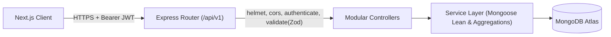

# Doctor Tracker — REST API Server

## Description

The **Doctor Tracker Server** is a modular, production-ready REST API built with **Node.js, Express, TypeScript, and MongoDB (Mongoose)**. It powers the Doctor Tracker clinical administration portal with JWT Bearer authentication, Zod request validation, indexed search and multi-criteria filtering, server-side pagination, and MongoDB aggregation pipelines for real-time healthcare analytics.

---

## Live Deployment

- **Base API URL (Render)**: `https://server-doctor-tracker.onrender.com/api/v1`
- **Health Check**: `GET https://server-doctor-tracker.onrender.com/health`
- **Seeded Admin Login**: `admin@dt.com` / `Admin@123`

---

## Setup Guide

### Prerequisites
- **Node.js** v20+ (tested on v22.14.0 & v24.x)
- **MongoDB** (local instance or MongoDB Atlas cluster)
- **npm** v10+

### 1. Configure Environment Variables

Copy `.env.example` to `.env` in `Server-Care-Guide/`:

```bash
cp .env.example .env
```

**`.env.example`**
```env
PORT=5000
NODE_ENV=development
MONGODB_URI=mongodb://localhost:27017/doctor_tracker
JWT_SECRET=change_this_to_a_long_random_secret_key
JWT_EXPIRES_IN=7d
CLIENT_URL=http://localhost:3000
```

### 2. Install, Seed & Run

```bash
npm install
npm run seed
npm run dev
```

### 3. Build for Production

```bash
npm run build
npm start
```

---

## API Endpoints (`/api/v1`)

| Module | Method & Path | Description | Auth |
| :--- | :--- | :--- | :--- |
| **Health** | `GET /health` | Server health status | Public |
| **Auth** | `POST /api/v1/auth/login` | Admin login & JWT token issuance | Public |
| **Auth** | `GET /api/v1/auth/me` | Get authenticated admin profile | Bearer JWT |
| **Doctors** | `GET /api/v1/doctors` | Paginated, searchable & filterable doctor list | Bearer JWT |
| **Doctors** | `POST /api/v1/doctors` | Create a new doctor | Bearer JWT |
| **Doctors** | `GET /api/v1/doctors/:id` | Get doctor details with assigned patients | Bearer JWT |
| **Doctors** | `PATCH /api/v1/doctors/:id` | Update doctor information | Bearer JWT |
| **Doctors** | `DELETE /api/v1/doctors/:id` | Delete doctor record | Bearer JWT |
| **Patients** | `GET /api/v1/patients` | Paginated, searchable & filterable patient list | Bearer JWT |
| **Patients** | `POST /api/v1/patients` | Add a patient under a specific doctor | Bearer JWT |
| **Patients** | `PATCH /api/v1/patients/:id` | Update patient information | Bearer JWT |
| **Patients** | `DELETE /api/v1/patients/:id` | Delete patient record | Bearer JWT |
| **Analytics** | `GET /api/v1/analytics/overview` | Totals, patients per doctor, conditions & date stats | Bearer JWT |

---

## System Architecture



---

## Technical Decisions

### 1. Modular Feature Architecture + Zod Schema Validation
- Each domain (`auth`, `doctor`, `patient`, `analytics`) encapsulates its own Mongoose model, Zod validation schema, service layer, controller, and router, keeping route handlers thin and testable.
- Incoming bodies, query parameters, and route params are validated before hitting MongoDB, returning consistent structured error responses via `error.middleware.ts`.

### 2. MongoDB Compound Indexes & Aggregation Pipelines
- Compound indexes (`specialization + createdAt`, `hospital + createdAt`, `doctorId + createdAt`, `condition + createdAt`) optimize filtered, paginated `.find().lean()` queries paired with parallel `.countDocuments()`.
- `analytics.service.ts` computes `patientsPerDoctor`, `conditionDistribution`, and `dateStats` directly inside MongoDB via `$lookup`, `$group`, and `$dateToString`.
